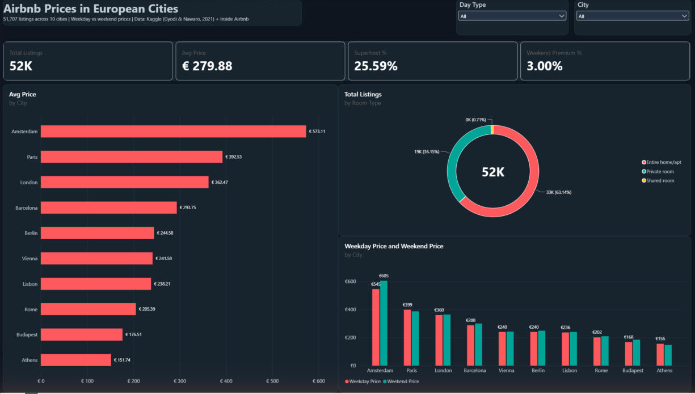
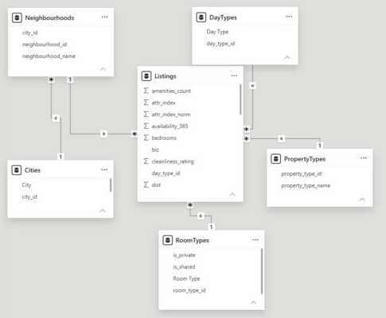
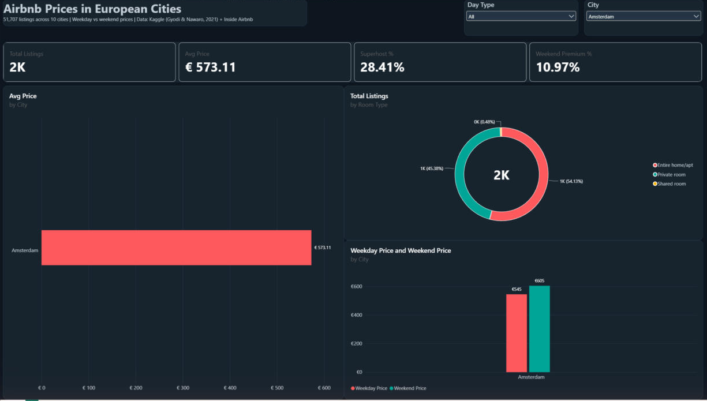

# Airbnb Prices in European Cities — End-to-End Data Analysis

An end-to-end analytics project on **51,707 Airbnb listings across 10 European cities** (Amsterdam, Athens, Barcelona, Berlin, Budapest, Lisbon, London, Paris, Rome, Vienna): from raw CSV files to a cleaned dataset, a normalized SQL Server database and an interactive Power BI dashboard.



---

## Pipeline

| Step | What | Tools |
|---|---|---|
| 1. Connect | Load 20 CSV files (10 cities × weekdays/weekends), add `city` and `day_type` labels, append into one master table | Python, pandas |
| 2. Missing values & extra features | Null check, price–feature correlation check, collect extra features (amenities, reviews, rating, property type, neighbourhood, availability), match and fill gaps | Selenium, requests, scikit-learn (BallTree) |
| 3. Save | Export the cleaned dataset (51,707 × 29) to Excel | pandas |
| 4. SQL normalization | Import into SQL Server, split into 6 tables in 3NF with primary/foreign keys | SQL Server, T-SQL, pyodbc |
| 5. Dashboard | Connect Power BI to SQL Server, relationships, DAX measures, custom dark theme | Power BI, DAX |

## Step 2 in detail — collecting extra features

The original dataset showed only **weak correlations** between price and the existing features (strongest: attraction index, *r* = 0.29). To add more features:

- Airbnb's terms don't allow scraping and the dataset has no listing IDs, so **Selenium** collects the download links from the public **[Inside Airbnb](https://insideairbnb.com/get-the-data/)** data page (CC BY 4.0) for all 10 cities.
- 309,154 Inside Airbnb listings were loaded, and each original listing was matched to its **nearest listing with the same room type** using a haversine BallTree (match rate **96.9%** within 200 m).
- Unmatched rows became the missing values to handle: numeric features filled with the **city median**, text features with `"Unknown"` → **0 nulls left**.

> Note: Inside Airbnb data is from September 2026, while the original dataset is older, so a match means "the nearest comparable listing", not the same listing.

## Step 4 — normalized schema (3NF)

```
Cities ─1:N─ Neighbourhoods ─1:N─ Listings ─N:1─ RoomTypes      (room_type, is_shared, is_private)
                                          ├─N:1─ PropertyTypes
                                          └─N:1─ DayTypes
```

| Table | Rows |
|---|---|
| Cities | 10 |
| DayTypes | 2 |
| RoomTypes | 3 |
| PropertyTypes | 66 |
| Neighbourhoods | 355 |
| Listings | 51,707 |

`room_shared` / `room_private` were fully determined by `room_type`, so they moved to `RoomTypes`; `city` is reached through `Neighbourhoods` (no transitive dependency in `Listings`).



## Key findings

- **Amsterdam is the most expensive city** (avg €573 for 2 nights, 2 people) — about **3.8×** Athens (€152).
- **Weekends cost 3% more overall**, but the gap varies: **+11% in Amsterdam**, while Paris and Athens are slightly cheaper at weekends.
- **Entire homes are 63% of listings** and average €324 vs €205 for private rooms.
- The extra features (reviews, rating, amenities, availability) **did not improve correlation with price** (all |r| < 0.05). Location (closeness to attractions) and size (bedrooms, capacity) matter more.



## Repository structure

```
notebooks/airbnb_analysis.ipynb   Steps 1–3 (load, missing values, Selenium, matching, export) with outputs
sql/step4_normalize.sql          Step 4 normalization script (tables, PK/FK, inserts, checks)
scripts/step4_sql.py             Imports the cleaned Excel into SQL Server and runs the SQL script
powerbi/airbnb_dashboard_pro.pbix  Step 5 Power BI report
powerbi/airbnb_dark_theme.json   Custom Power BI theme
images/                          Dashboard screenshots
```

## How to run

1. Download the dataset from [Kaggle — Airbnb Prices in European Cities](https://www.kaggle.com/datasets/thedevastator/airbnb-prices-in-european-cities) and update the `folder` path in the notebook.
2. `pip install pandas numpy scikit-learn selenium requests openpyxl pyodbc sqlalchemy`
3. Run `notebooks/airbnb_analysis.ipynb` (Selenium uses Microsoft Edge).
4. Run `scripts/step4_sql.py` with SQL Server Express installed.
5. Open `powerbi/airbnb_dashboard_pro.pbix` and point the source to your SQL Server.

## Data sources

- Gyódi, K. & Nawaro, Ł. (2021). *Determinants of Airbnb prices in European cities: A spatial econometrics approach.* Dataset via [Zenodo](https://zenodo.org/records/4437020) / Kaggle.
- [Inside Airbnb](https://insideairbnb.com/) — licensed under [CC BY 4.0](https://creativecommons.org/licenses/by/4.0/).
